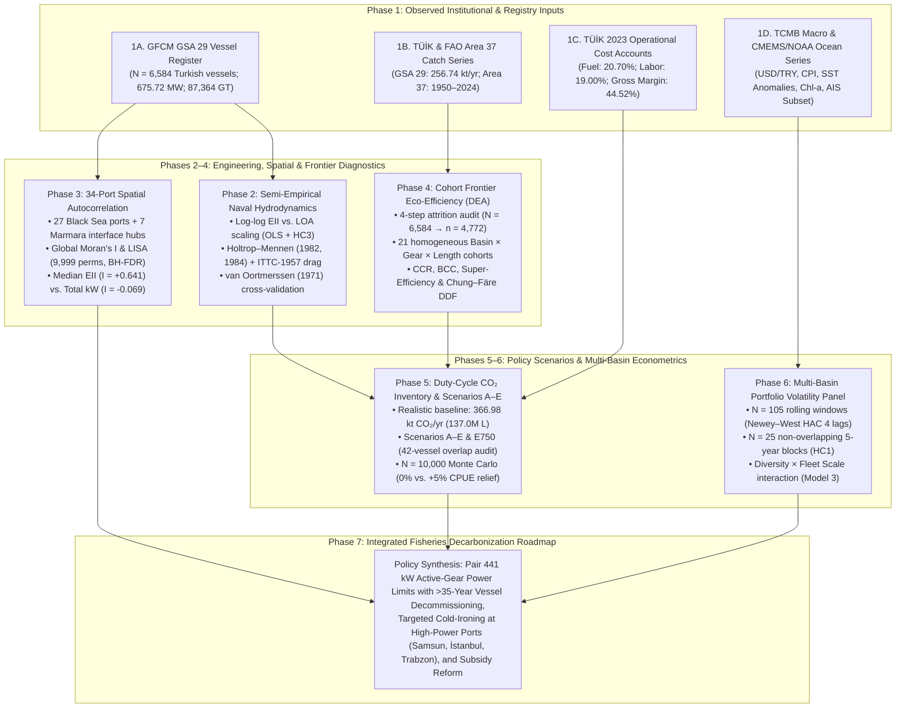

# Decarbonizing Turkish Black Sea Commercial Fisheries Requires Pairing Industrial Engine-Power Limits with Capacity Reduction

[](https://doi.org/10.52998/trjmms.2042258)
[](https://doi.org/10.5281/zenodo.24077970)
[](LICENSE)
[](requirements.txt)
[](https://orcid.org/0000-0001-6840-1466)

> **Official Replication Codebase** for the research article published in the ***Turkish Journal of Maritime and Marine Sciences* (TrJMMS)**:  
> **English Title:** *Decarbonizing Turkish Black Sea Commercial Fisheries Requires Pairing Industrial Engine-Power Limits with Capacity Reduction*  
> **Turkish Title (*Türkçe Başlık*):** *Türkiye Karadeniz Ticari Balıkçılığının Karbonsuzlaştırılması Endüstriyel Motor Gücü Sınırları ile Kapasite Azaltımının Birlikte Uygulanmasını Gerektirmektedir*  
> **Author:** Sezgin Tunca, Ph.D. (Independent Researcher, Foça, İzmir, Türkiye; ORCID: [`0000-0001-6840-1466`](https://orcid.org/0000-0001-6840-1466))  
> **Article DOI:** [`10.52998/trjmms.2042258`](https://doi.org/10.52998/trjmms.2042258) | **Zenodo Code Archive DOI:** [`10.5281/zenodo.24077970`](https://doi.org/10.5281/zenodo.24077970)

---

## Abstract

Commercial marine capture fisheries in the Black Sea (General Fisheries Commission for the Mediterranean [GFCM] Geographical Subarea [GSA] 29) face structural overcapacity, high fuel cost exposure, and ecological volatility. This study integrates vessel-level GFCM registry microdata ($N = 6,584$ active Turkish vessels; $675,722.62\text{ kW}$; $87,363.60\text{ GT}$), national landings and cost accounts from the Turkish Statistical Institute (TÜİK, $2000\text{--}2024$), historical regional catch series from the Food and Agriculture Organization (FAO Major Area 37, $1950\text{--}2024$), and semi-empirical naval hydrodynamic resistance models to evaluate fleet decarbonization pathways. Evaluated against gear-specific engineering benchmarks ($\text{PS}: 3\text{--}6\text{ kW GT}^{-1}$; $\text{OTB/PTM/DRB}: 6\text{--}10\text{ kW GT}^{-1}$; $\text{TBB/MIS}: 4\text{--}12\text{ kW GT}^{-1}$) alongside displacement-normalized ratios ($\text{kW t}^{-1}$), elevated engine intensity is concentrated in active mobile gears ($43.90\%$ of trawlers and $60.00\%$ of dredgers exceed $10\text{ kW GT}^{-1}$; $19.71\%$ of purse seiners exceed $6\text{ kW GT}^{-1}$). Semi-empirical Holtrop–Mennen calculations indicate that calm-water wave-making drag accounts for $58.24\%\text{--}79.44\%$ of hull resistance during free-running transit ($Fn = 0.348\text{--}0.444$) but $<1.3\%$ during low-speed towing ($2.0\text{--}3.0\text{ knots}$), confirming that trawler propulsion sizing is governed by gear-drag bollard pull rather than transit hull resistance. Port-level spatial autocorrelation across 27 Black Sea coastal ports reveals strong clustering in median engine intensity (Moran's $I = +0.6408$, $p = 0.0001$; Western shelf High-High cluster versus Eastern pelagic Low-Low zone) but spatial randomness in aggregate engine power ($I = -0.0691$, $p = 0.4731$). Under a gear-differentiated operational duty-cycle inventory calibrated to 2023 TÜİK fuel expenditures ($137.00\text{ million L}$ diesel), baseline fleet emissions equal $366.98\text{ kt CO}_2\text{ yr}^{-1}$ ($85.75\%$ from $757$ industrial trawlers and purse seiners), compared with $784.92\text{ kt CO}_2\text{ yr}^{-1}$ under a uniform industrial upper-bound sensitivity envelope. Cohort Data Envelopment Analysis ($K = 21$ cohorts, $n = 4,772$ vessels) identifies $30.37\text{ kt CO}_2\text{ yr}^{-1}$ ($9.94\%$) in technical slack. Combining a $441.0\text{ kW}$ active-gear main-engine limit with retirement of $658$ vessels $>35\text{ years}$ old (accounting for $42$ overlapping vessels) reduces operational $\text{CO}_2$ emissions by $29.31\%$ ($-107.55\text{ kt yr}^{-1}$). Multi-basin panel regressions ($N = 105$ overlapping windows with Newey–West HAC standard errors; $N = 25$ non-overlapping blocks) indicate that catch diversity is associated with lower revenue volatility at smaller fleet scales ($\hat{\beta}_{H'} = -2.1695$, $p = 0.0139$) but that this buffering attenuates as vessel numbers expand ($\hat{\beta}_{H'\times\ln V} = +0.2648$, $p = 0.0108$).

---

## Methodological Architecture



---

## Repository Structure

> **Data Governance Policy:** No raw or processed datasets (`.csv`, `.xlsx`, `.geojson`) are distributed in this repository or on Zenodo. All institutional data sources and retrieval procedures are documented in [`data/README.md`](data/README.md).

```text
blacksea-fisheries-decarbonization-capacity/
├── README.md                                        # Project overview, methodology, and replication guide
├── LICENSE                                          # MIT Open-Source License
├── requirements.txt                                 # Pinned Python scientific dependencies
├── .zenodo.json                                     # Zenodo metadata descriptor (DOI: 10.5281/zenodo.24077970)
├── .gitignore                                       # Excludes all local datasets (.csv, .xlsx) and caches
├── data/
│   └── README.md                                    # Official institutional data sources & schema guide
├── scripts/
│   ├── README.md                                    # Detailed script-by-script pipeline documentation
│   ├── 00_run_all_pipeline.py                       # Master sequential pipeline orchestrator (Steps 01–08)
│   ├── 01_compile_fleet_and_economic_data.py        # GSA 29 fleet architecture & TÜİK cost accounts
│   ├── 02_compile_fao_catch_benchmarks.py           # FAO Area 37 historical landings & FUI index
│   ├── 03_simulate_decarbonisation_scenarios.py     # Duty-cycle CO₂, Scenarios A–E, Monte Carlo & HAC panel
│   ├── 04_model_hydrodynamic_froude_scaling.py      # Naval scaling, Holtrop–Mennen & van Oortmerssen drag
│   ├── 05_model_dea_eco_efficiency.py               # 21-cohort CCR/BCC DEA, DDF slack & allocation checks
│   ├── 06_analyze_spatial_autocorrelation.py        # 34-port geocoding, Global Moran's I & dual LISA
│   ├── 07_extract_blacksea_ais_validation.py        # Illustrative GFW satellite AIS speed check & Fig S2
│   └── 08_generate_publication_figures.py           # 600-DPI master publication figure suite (Figs 1–7, S1)
└── figures/
    ├── FIGURE_ALT_TEXT_DESCRIPTIONS.md              # Captions and accessibility alt-text for all figures
    ├── fig1_methodological_workflow.png / .pdf      # Figure 1: Seven-stage methodological framework
    ├── fig2_study_area_map.png / .pdf               # Figure 2: GSA 29 bathymetric map & capacity dashboard
    ├── fig3_hydrodynamic_froude_scaling.png / .pdf  # Figure 3: Naval scaling & Holtrop–Mennen wave drag
    ├── fig4_comparative_blacksea_dynamics.png / .pdf# Figure 4: FAO Area 37 vs. GSA 29 production & value
    ├── fig5_turkish_port_bubble_maps.png / .pdf     # Figure 5: 4-panel port capacity & Moran's I maps
    ├── fig6_decarbonisation_tradeoffs.png / .pdf    # Figure 6: Scenarios A–E, fuel shocks & portfolio panel
    ├── fig7_dea_eco_efficiency_frontiers.png / .pdf # Figure 7: 21-cohort DEA frontier & abatement slack
    ├── figS1_supplementary_diagnostics.png / .pdf   # Figure S1: Age structure, Moran scatter & CO₂ bounds
    └── figS2_ais_speed_validation.png / .pdf        # Figure S2: Illustrative AIS working-speed telemetry
```

---

## Summary of Key Empirical Findings

### 1. Turkish GSA 29 Fleet Architecture & Duty-Cycle $\text{CO}_2$ Inventory ($N = 6,584$)

| Gear Segment | Vessels ($n$) | Fleet Share ($\%$) | Certified Power ($\text{kW}$) | Mean $\text{EII}$ ($\text{kW GT}^{-1}$) | Realistic Duty-Cycle $\text{CO}_2$ ($\text{kt yr}^{-1}$) | Share of Realistic $\text{CO}_2$ ($\%$) | Uniform Upper-Bound $\text{CO}_2$ ($\text{kt yr}^{-1}$) |
| :--- | :---: | :---: | :---: | :---: | :---: | :---: | :---: |
| **Pelagic/Demersal Trawler (`OTB/PTM`)** | 549 | 8.34% | 213,279.74 | 10.67 | **172.93** | 47.12% | 247.75 |
| **Purse Seiner (`PS`)** | 208 | 3.16% | 147,471.26 | 4.81 | **141.74** | 38.62% | 171.30 |
| **Small-Scale / Polyvalent (`MIS`)** | 5,259 | 79.88% | 275,246.69 | 15.61 | **36.28** | 9.89% | 319.73 |
| **Beam Trawler (`TBB`)** | 548 | 8.32% | 33,254.15 | 11.79 | **11.73** | 3.20% | 38.63 |
| **Hydraulic Dredger (`DRB`)** | 20 | 0.30% | 6,470.78 | 12.14 | **4.30** | 1.17% | 7.52 |
| **Total Turkish GSA 29 Fleet** | **6,584** | **100.00%** | **675,722.62** | **14.53** | **366.98** | **100.00%** | **784.92** |

### 2. Conditional Decarbonization Policy Scenarios (Scenarios A–E & $\text{E}_{750}$)

| Policy Scenario | Active Vessels | Certified Power ($\text{kW}$) | Realistic $\text{CO}_2$ ($\text{kt yr}^{-1}$) | Realistic Abatement ($\text{kt yr}^{-1}$) | Realistic Reduction ($\%$) | Surviving Net Margin ($0\%$ / $+5\%$ Rebound) |
| :--- | :---: | :---: | :---: | :---: | :---: | :---: |
| **Baseline Status Quo (2024)** | 6,584 | 675,722.62 | 366.98 | — | 0.00% | 29.52% |
| **Scenario A: Active-Gear Power Limit ($441\text{ kW}$)** | 6,584 | 595,567.20 | 292.41 | -74.56 | **-20.32%** | 32.76% ($0\%$ rebound) |
| **Scenario B: Aging-Vessel Retirement ($>35\text{ yr}$)** | 5,926 | 600,455.97 | 322.91 | -44.06 | **-12.01%** | 29.70% ($\text{B}_0$) / 32.13% ($\text{B}$) |
| **Scenario C: Selective Gear Transition ($15\%$ Trawl)** | 6,584 | 615,281.07 | 338.01 | -28.97 | **-7.89%** | 30.36% ($0\%$ rebound) |
| **Scenario D: Propulsion & Auxiliary Retrofit ($-15\%$)** | 6,584 | 675,722.62 | 311.93 | -55.05 | **-15.00%** | 32.12% ($0\%$ rebound) |
| **Scenario E: Integrated Roadmap ($\text{A} \cup \text{B}$, 42 overlap)** | 5,926 | 531,995.78 | 259.43 | **-107.55** | **-29.31%** | 32.77% ($\text{E}_0$) / **35.06%** ($\text{E}$) |
| **Sensitivity $\text{E}_{750}$: Tiered $\ge 24\text{ m}$ PS Cap ($750\text{ kW}$) + B** | 5,926 | 557,300.62 | 283.73 | -83.25 | **-22.69%** | — |

---

## Reproducing the Analysis

1. **Clone the repository and install dependencies:**
   ```bash
   git clone https://github.com/SezginTunca/blacksea-fisheries-decarbonization-capacity.git
   cd blacksea-fisheries-decarbonization-capacity
   pip install -r requirements.txt
   ```

2. **Place the institutional input series in `data/`:**  
   Follow the schema and institutional portal links in [`data/README.md`](data/README.md).

3. **Execute the complete pipeline (`00`–`08`):**
   ```bash
   python3 scripts/00_run_all_pipeline.py
   ```

---

## Citation

If you use this codebase, analytical models, or visual framework in your research, please cite both the journal article and the archived software release:

```bibtex
@article{Tunca2026BlackSeaDecarbonization,
  author  = {Tunca, Sezgin},
  title   = {Decarbonizing {Turkish} {Black Sea} Commercial Fisheries Requires Pairing Industrial Engine-Power Limits with Capacity Reduction},
  journal = {Turkish Journal of Maritime and Marine Sciences},
  year    = {2026},
  doi     = {10.52998/trjmms.2042258},
  url     = {https://doi.org/10.52998/trjmms.2042258}
}

@software{Tunca2026BlackSeaCode,
  author    = {Tunca, Sezgin},
  title     = {Replication Codebase: Decarbonizing {Turkish} {Black Sea} Commercial Fisheries Requires Pairing Industrial Engine-Power Limits with Capacity Reduction},
  year      = {2026},
  publisher = {Zenodo},
  version   = {1.0.0},
  doi       = {10.5281/zenodo.24077970},
  url       = {https://doi.org/10.5281/zenodo.24077970}
}
```
